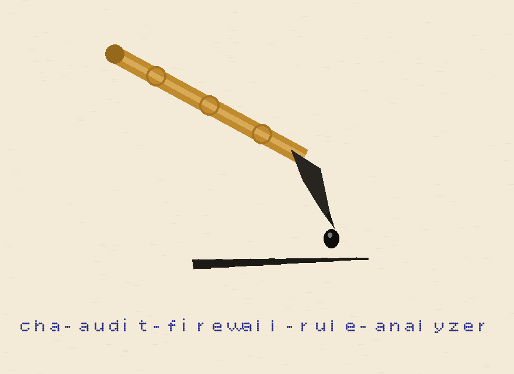

> Medium noted first: sumi ink on canvas cream practice paper, Bitcount Prop Single in pigment ultramarine, a studio inventory entry.

# cha-audit-firewall-rule-analyzer




# cha-audit-firewall-rule-analyzer
Analyzes firewall rules (iptables, firewalld, or Windows Firewall) to identify overly permissive or redundant rules, and can audit a YAML or JSON configuration against a baseline.


## Install
```
git clone https://github.com/ShadowGuard-AI/cha-audit-firewall-rule-analyzer
cd cha-audit-firewall-rule-analyzer
pip install -r requirements.txt
```


## Usage
```
python3 main.py -t TYPE [-c CONFIG] [-o OUTPUT]
```

> Ink stone tray: Type Is Required. The type choice, -t, also written --type, is the one required part of the command line, with the three accepted values iptables, firewalld, and windows.


## Parameters
- `-h`: show help message and exit.
- `-t`, `--type`: the type of firewall to analyze, required: `iptables`, `firewalld`, or `windows`.
- `-c`, `--config`: path to the configuration file (YAML or JSON).
- `-o`, `--output`: path to the output file for the report.


## Verified behavior
- Without `-c`, the tool runs the live firewall command for the chosen type: `iptables-save`, `firewall-cmd --list-all`, or `netsh advfirewall show allprofiles`. That live step was not run in this wave, because those commands are not available in this environment.
- Live run not possible in this environment: the `jsonpath_ng` package is not installed here and installs are not permitted in this wave. The parameter list above is taken from the argument parser in `main.py`, and the file compiles cleanly.

> Ink stone tray: Live Run Not Performed in This Wave. The cautions above are kept at full size: the live commands were not available in the documenting environment, and the package named there was not installed, with installs not permitted in that wave.


## License
MIT License, see LICENSE.
